# STRIDE - Fitness Activity Tracker

A full-stack fitness activity tracking application inspired by Strava. Track your workouts, join challenges, connect with other athletes, and achieve your fitness goals.

> **Note:** This project is currently in active development. Features and UI may change.

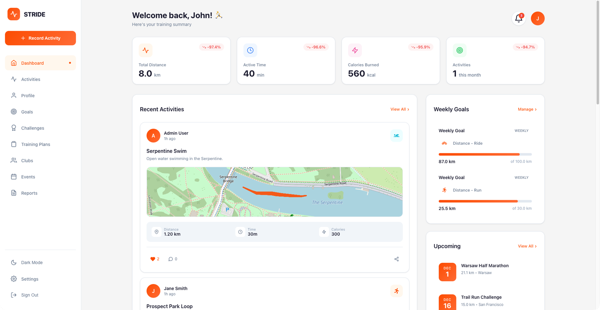

## Features

### Activity Tracking
- Record and track various activity types (Running, Cycling, Swimming, Hiking, Workouts)
- View detailed activity statistics (distance, duration, pace, calories, elevation)
- Like and comment on activities
- Add reactions to comments

### Social Features
- Follow other athletes
- Activity feed showing followed users' activities
- Clubs - join communities based on sport types
- Events - create and join local fitness events

### Challenges
- Join monthly challenges
- Track progress against goals
- Leaderboard rankings
- Earn badges for completing challenges

### Goals & Progress
- Set personal fitness goals
- Track weekly and monthly progress
- Visual progress charts and statistics

### User Experience
- Dark/Light theme toggle
- Responsive design
- Real-time notifications
- User profile customization

## Screenshots

<details>
<summary>Click to expand all screenshots</summary>

### Authentication

#### Login
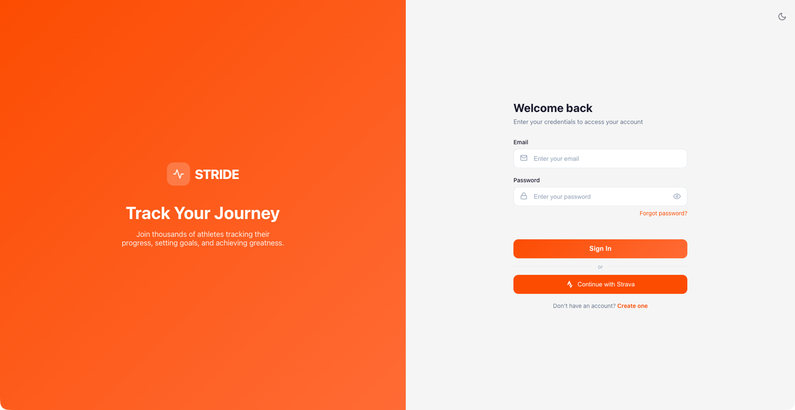
*Clean login page with email and password fields, password visibility toggle*

#### Register

*Registration form with password strength indicator*

---

### Main Application

#### Dashboard

*Main dashboard with stats cards, weekly chart, recent activities, and goals progress*

#### Dashboard - User Menu

*User avatar dropdown with profile link, settings, and logout*

---

### Activities

#### Activities Feed
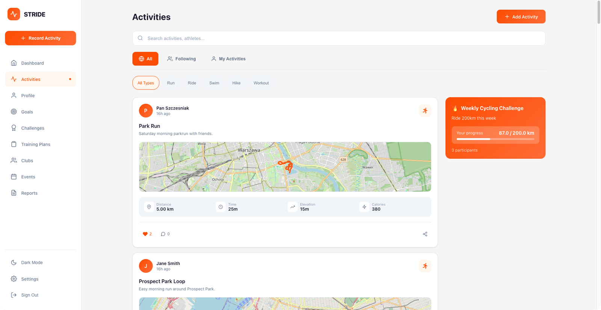
*Activity feed with filters (All/Following/My Activities), type filtering, and sidebar*

#### Record Activity
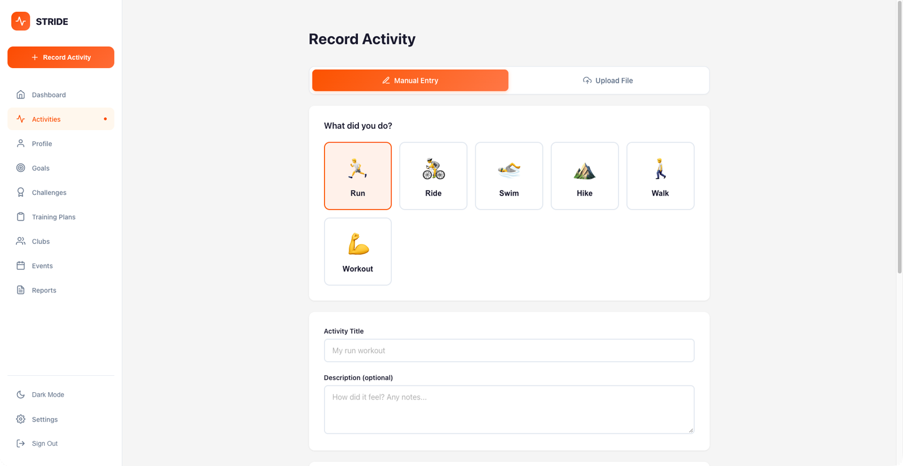
*Create new activity - select type (Run, Ride, Swim, Hike, Walk, Workout) and enter stats*

#### Activity Details
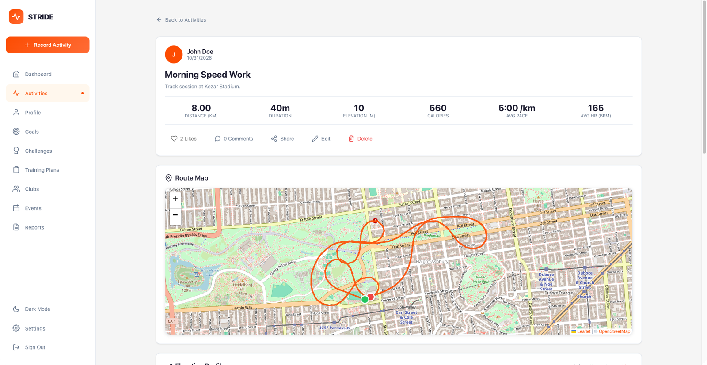
*Full activity view with stats, map, comments section, and like/share buttons*

---

### Profile

#### User Profile
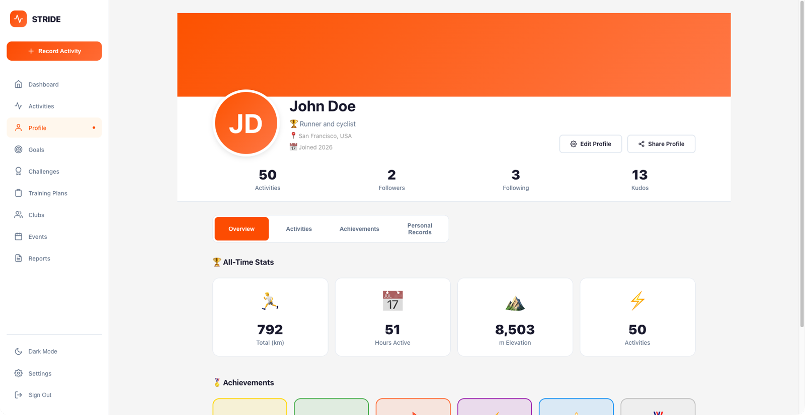
*User profile with cover photo, avatar, stats (followers, following, activities)*

#### Profile - Stats Tab

*Detailed statistics with charts and visualizations*

---

### Goals & Challenges

#### Goals
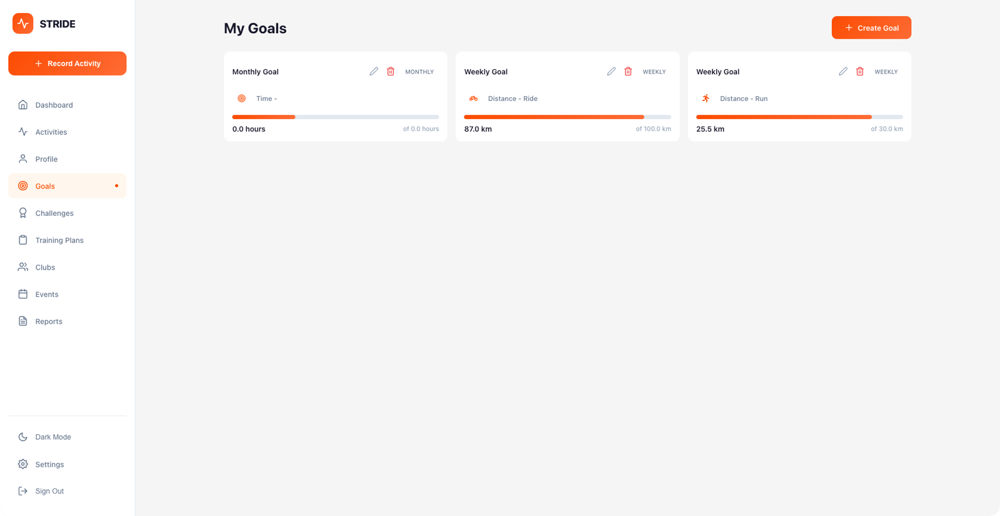
*Personal fitness goals with progress bars and deadlines*

#### Challenges
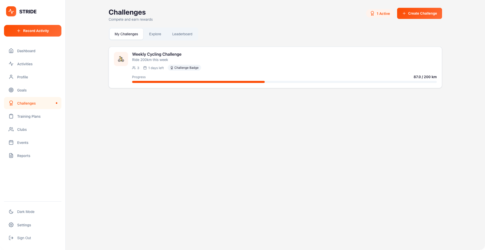
*Active challenges with progress tracking and participant counts*

---

### Social Features

#### Clubs
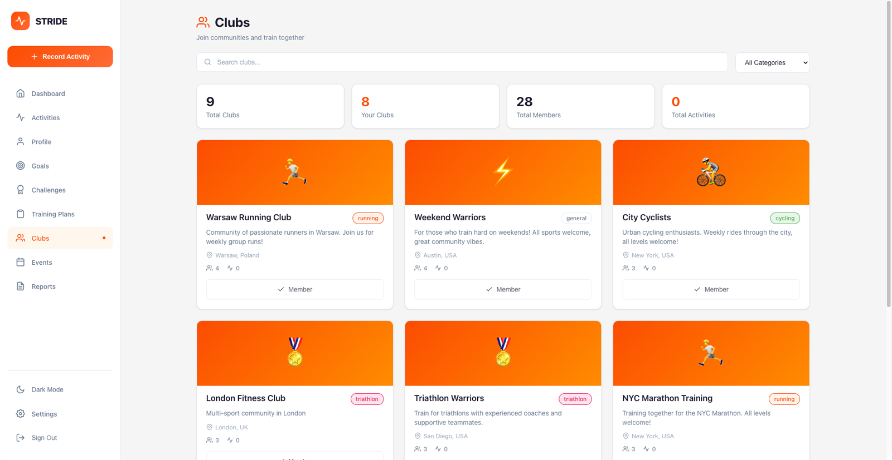
*Sport communities - browse, search, and join clubs*

#### Events
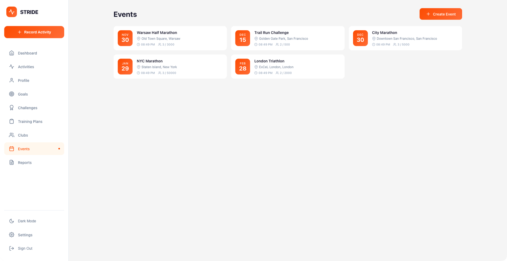
*Local fitness events with date, location, and registration*

#### Create Event
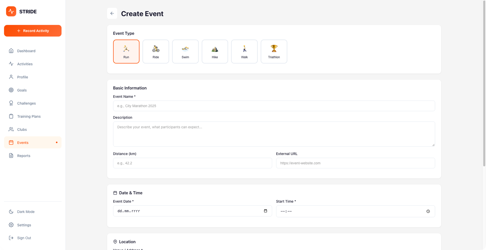
*Event creation form with date picker, location, and details*

---

### Training

#### Training Plans
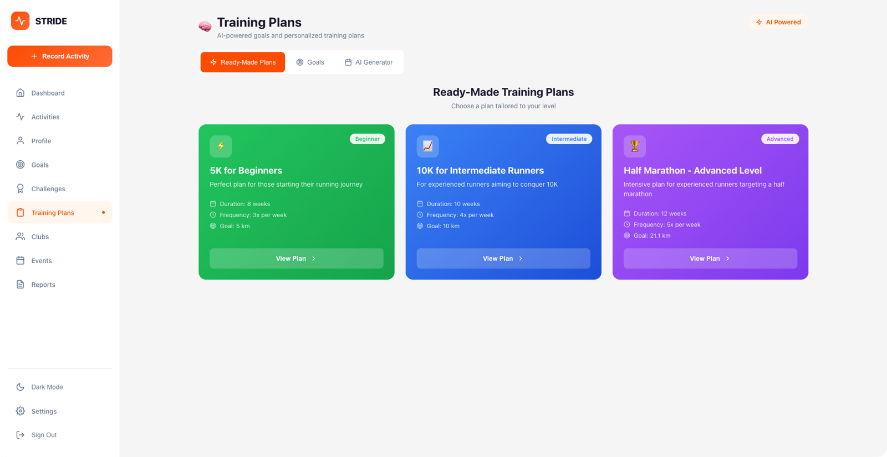
*AI-generated training plans with workouts schedule*

---

### Settings

#### Settings - Profile
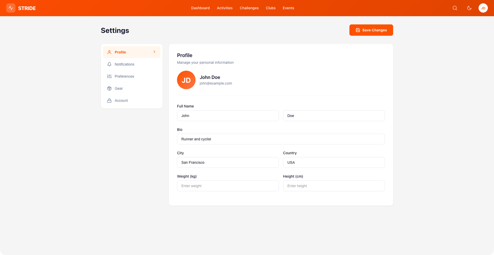
*Edit profile information - name, bio, location, weight, height*

#### Settings - Preferences
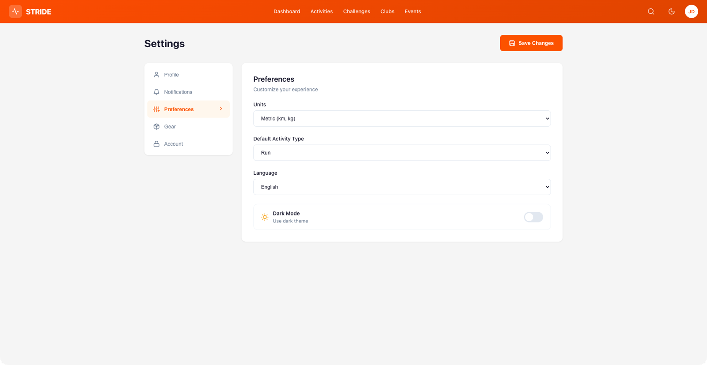
*App preferences - notifications, units, language, theme*

---

### Admin Panel

#### Admin - Overview
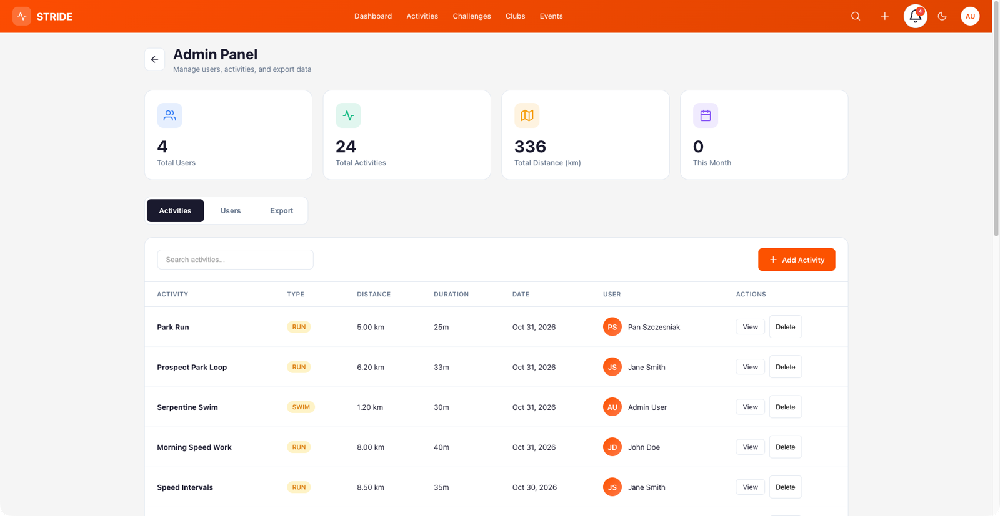
*Admin dashboard with user and activity statistics*

#### Admin - Users
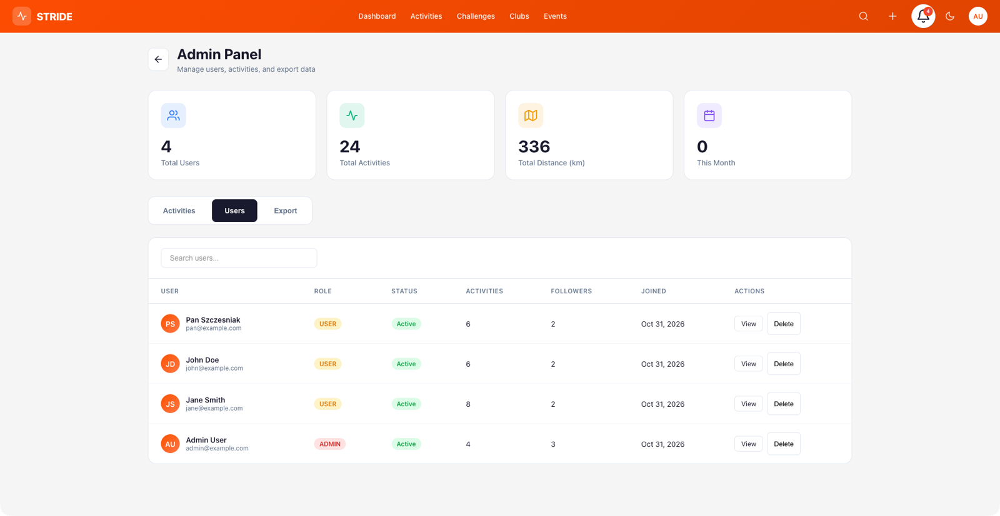
*User management table with search and actions*

#### Admin - Export
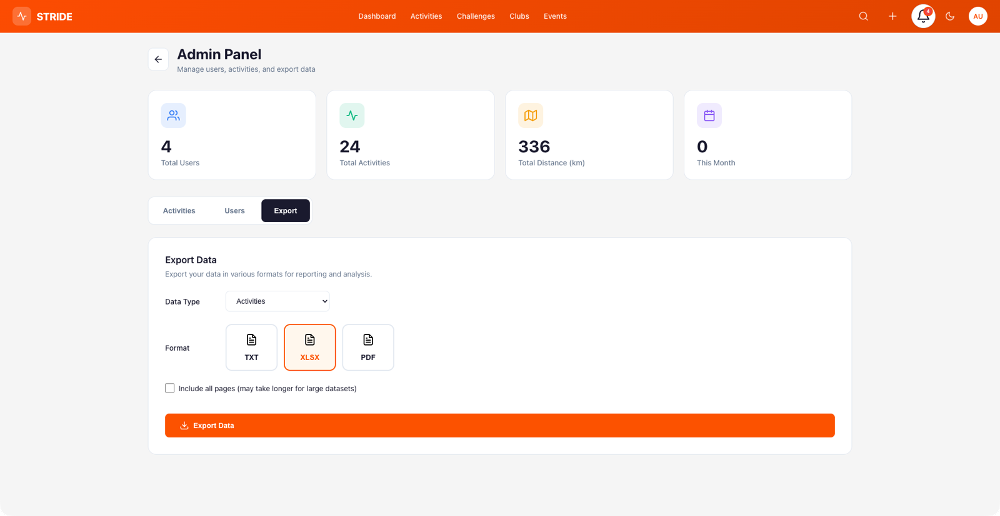
*Export data to Excel/PDF*

---

### Theme Variants

#### Light Mode

*Default light theme*

#### Dark Mode
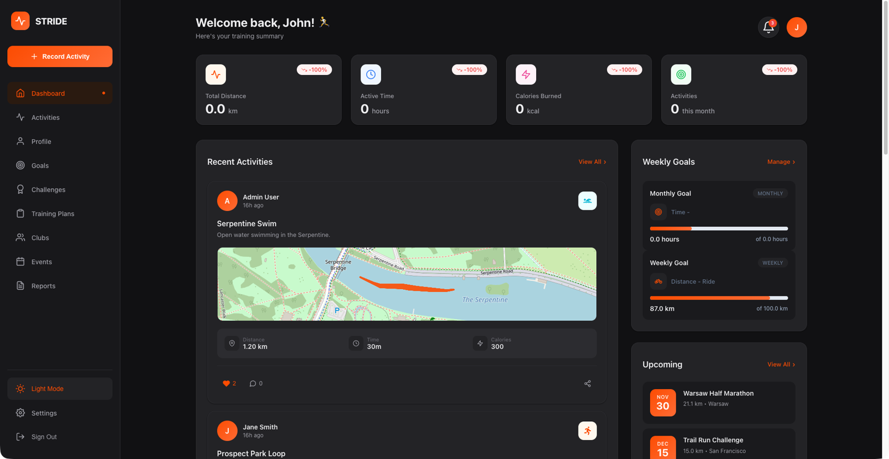
*Full dark mode support across all pages*

---

### Responsive Design

#### Mobile View
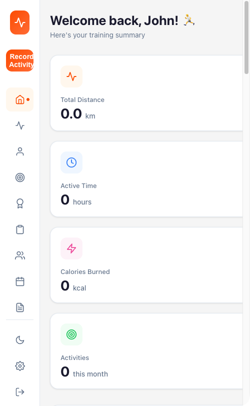
*Responsive layout optimized for mobile devices*

</details>

## Tech Stack

### Backend
- **Java 21** with **Spring Boot 3.4**
- **Spring Security** with JWT authentication
- **Spring Data JPA** with PostgreSQL
- **GraphQL** API support
- **Flyway** for database migrations
- **Swagger/OpenAPI** documentation
- **Testcontainers** for integration testing

### Frontend
- **React 18** with Hooks
- **React Router** for navigation
- **Styled Components** for styling
- **Recharts** for data visualization
- **Axios** for API communication
- **React Icons** for iconography

### Infrastructure & Observability
- **Docker** & **Docker Compose**
- **PostgreSQL 16**
- **Nginx** (production)
- **Prometheus** + **Grafana** for metrics & dashboards
- **Structured logging** (JSON in prod via Logstash encoder)
- **Rate limiting** on auth endpoints

## Getting Started

### Quick Start with Docker (Recommended)

The easiest way to run the application is with Docker Compose.

#### Prerequisites
- Docker & Docker Compose
- Make (optional, for convenience commands)

#### Run the Application

```bash
# Clone the repository
git clone https://github.com/erykszczesniak/strava.git
cd strava

# Start all services (backend, frontend, PostgreSQL)
make up

# Or without make:
docker compose up -d --build
```

That's it! The application will be available at:
- **Frontend:** http://localhost (port 80)
- **Backend API:** http://localhost:8080
- **Swagger UI:** http://localhost:8080/swagger-ui.html
- **GraphQL:** http://localhost:8080/graphql
- **Grafana:** http://localhost:3001 (admin/admin)
- **Prometheus:** http://localhost:9090

#### Sample Users

| Email | Password | Role |
|-------|----------|------|
| john@example.com | password123 | USER |
| jane@example.com | password123 | USER |
| admin@example.com | admin123 | ADMIN |

#### Useful Commands

```bash
# View logs
make logs

# Stop all services
make down

# Restart backend only
docker compose restart backend

# Access database
docker compose exec db psql -U strava -d stravadb

```

> For more Docker commands, see [DOCKER.md](DOCKER.md)

---

### Manual Setup (Development)

If you prefer to run services manually without Docker.

#### Prerequisites
- Java 21+
- Node.js 18+
- Maven 3.9+

#### Backend

```bash
# Clone and enter directory
git clone https://github.com/erykszczesniak/strava.git
cd strava

# Run with H2 in-memory database (default for dev)
./mvnw spring-boot:run
```

The API will be available at `http://localhost:8080`

#### Frontend

```bash
cd frontend
npm install
npm start
```

The app will be available at `http://localhost:3000`

## API Documentation

Once the backend is running, API documentation is available at:
- **Swagger UI:** http://localhost:8080/swagger-ui.html
- **GraphQL Playground:** http://localhost:8080/graphql

### REST API Endpoints

| Endpoint | Description |
|----------|-------------|
| `POST /api/v1/auth/register` | User registration |
| `POST /api/v1/auth/login` | User login |
| `GET /api/v1/activities` | Get activities |
| `POST /api/v1/activities` | Create activity |
| `GET /api/v1/challenges` | Get challenges |
| `GET /api/v1/clubs` | Get clubs |
| `GET /api/v1/events` | Get events |
| `GET /api/v1/users/profile` | Get user profile |

## Project Structure

```
strava/
├── docker-compose.yml     # Docker services configuration
├── Dockerfile             # Backend Docker image
├── Makefile               # Convenience commands
├── DOCKER.md              # Docker commands reference
├── monitoring/
│   ├── prometheus/        # Prometheus scrape config
│   └── grafana/           # Grafana dashboards & provisioning
├── src/main/java/com/strava/backend/
│   ├── configuration/     # Spring configurations
│   ├── controller/        # REST controllers
│   ├── domain/            # Entity models
│   ├── dto/               # Data transfer objects
│   ├── graphql/           # GraphQL resolvers
│   ├── repository/        # JPA repositories
│   ├── security/          # JWT & auth
│   └── service/           # Business logic
├── frontend/
│   ├── Dockerfile         # Frontend Docker image
│   ├── nginx.conf         # Nginx configuration
│   ├── src/
│   │   ├── api/           # API services
│   │   ├── components/    # Reusable components
│   │   ├── context/       # React contexts
│   │   ├── pages/         # Page components
│   │   └── styles/        # Theme & global styles
│   └── public/
└── docs/                   # Documentation & screenshots
```

## Observability & Security

### Monitoring (Prometheus + Grafana)

Prometheus scrapes backend metrics every 15s. Grafana comes with a pre-built **JVM & Spring Boot** dashboard.

```bash
# Start the full stack (includes Prometheus + Grafana)
docker compose up -d --build
```

**Prometheus** — http://localhost:9090

Check targets status at [/targets](http://localhost:9090/targets) — backend should show as `UP`.

Example queries to try in [/graph](http://localhost:9090/graph):

```promql
# HTTP request rate per endpoint
rate(http_server_requests_seconds_count[1m])

# Response time (p95)
histogram_quantile(0.95, rate(http_server_requests_seconds_bucket[5m]))

# JVM heap memory usage
jvm_memory_used_bytes{area="heap"}

# CPU usage
process_cpu_usage

# HikariCP active connections
hikaricp_connections_active

# GC pause duration
rate(jvm_gc_pause_seconds_sum[1m])
```

**Grafana** — http://localhost:3001 (login: `admin` / `admin`)

Go to **Dashboards → Strava Backend - JVM & Spring Boot** to see:
- HTTP request rate, p95 latency, error rates (4xx/5xx)
- JVM heap & non-heap memory
- GC pause duration
- Thread counts (live, daemon, peak)
- System & process CPU usage
- HikariCP connection pool (active, idle, pending, total)

### Structured Logging

Logging format depends on the active Spring profile:

| Profile | Format | Use case |
|---------|--------|----------|
| `dev` (default) | Colored console | Local development |
| `prod` | JSON (Logstash encoder) | Production / log aggregation |

```bash
# View backend logs (dev - human readable)
docker compose logs -f backend

# Test JSON output with prod profile
SPRING_PROFILES_ACTIVE=prod docker compose up backend
```

Example JSON log line (prod):
```json
{
  "@timestamp": "2026-03-10T16:40:12.345Z",
  "level": "INFO",
  "logger_name": "c.s.b.StravaApplication",
  "message": "Started StravaApplication in 4.2 seconds",
  "thread_name": "main"
}
```

### Rate Limiting

Auth endpoints are protected against brute-force attacks with a per-IP sliding window rate limiter:

| Endpoint | Limit | Window |
|----------|-------|--------|
| `POST /api/v1/auth/login` | 10 requests | 1 minute |
| `POST /api/v1/auth/register` | 5 requests | 1 minute |

When the limit is exceeded, the API returns `429 Too Many Requests`:

```json
{"error": "Too many requests. Please try again later."}
```

Test it:

```bash
# Send 12 login requests — the last 2 should return 429
for i in $(seq 1 12); do
  echo "Request $i: $(curl -s -o /dev/null -w '%{http_code}' \
    -X POST http://localhost:8080/api/v1/auth/login \
    -H 'Content-Type: application/json' \
    -d '{"email":"test@test.com","password":"wrong"}')"
done
```

Expected output:
```
Request 1: 401
...
Request 10: 401
Request 11: 429
Request 12: 429
```

---

## Running Tests

### Backend Tests
```bash
./mvnw test
```

### Frontend Tests
```bash
cd frontend
npm test
```

## Contributing

1. Fork the repository
2. Create your feature branch (`git checkout -b feature/amazing-feature`)
3. Commit your changes (`git commit -m 'Add amazing feature'`)
4. Push to the branch (`git push origin feature/amazing-feature`)
5. Open a Pull Request

## License

This project is for educational purposes.

## Acknowledgments

- Inspired by [Strava](https://www.strava.com/)
- Icons by [React Icons](https://react-icons.github.io/react-icons/)
- Charts by [Recharts](https://recharts.org/)
