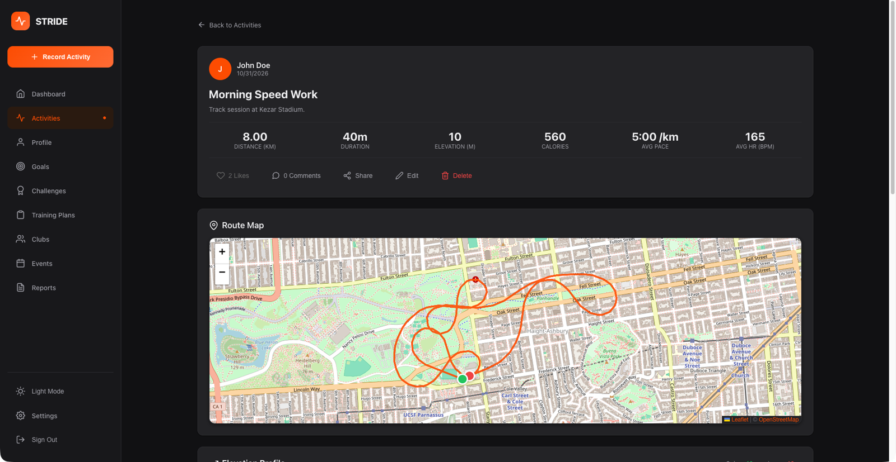
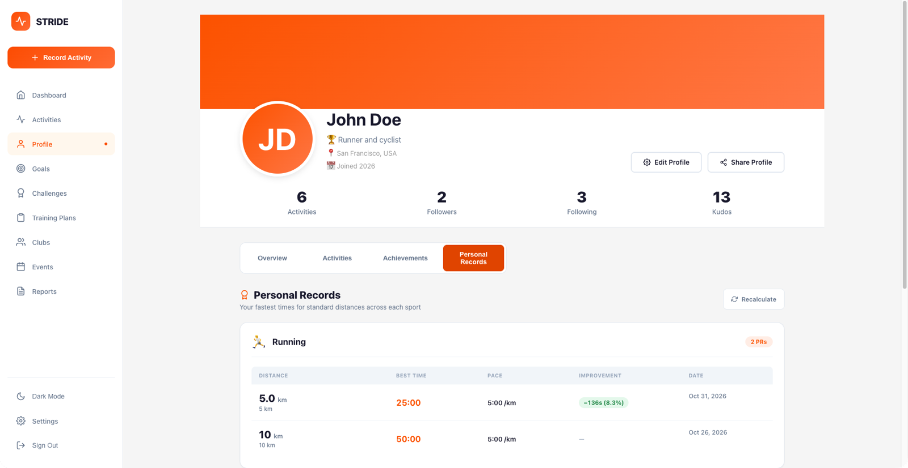
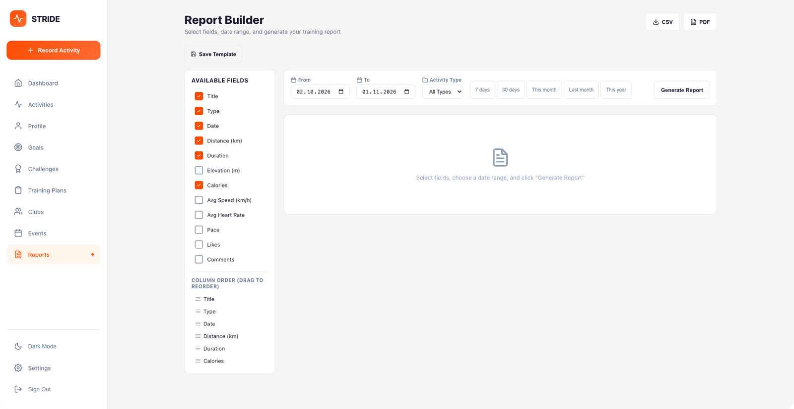
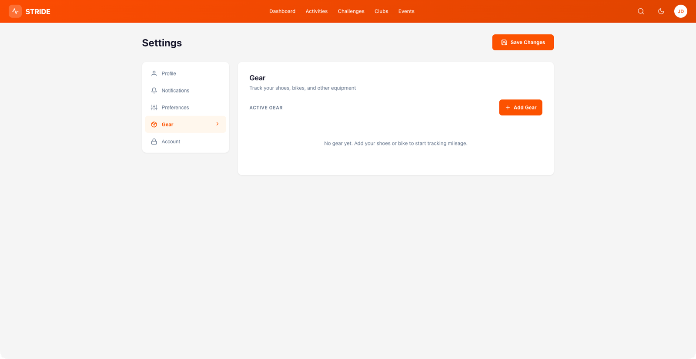

# Stride - Fitness Activity Tracker

Stride is a full-stack fitness platform inspired by Strava. Record workouts,
analyze progress, follow athletes, join events and use an AI coach. This
`main` branch is a Spring Boot monolith. The
[`microservices`](https://github.com/erykszczesniak/Stride/tree/microservices)
branch provides the same product as 12 services.

**Built with:** Java 21, Kotlin, Spring Boot, React, PostgreSQL, Elasticsearch,
Docker, Kubernetes and Terraform.


> The project is under active development. Features and UI may change.

## Table of contents

- [Technologies](#technologies)
- [Project structure](#project-structure)
- [How to run](#how-to-run)
- [Screenshots](#screenshots)
- [Features](#features)
- [API documentation](#api-documentation)
- [Observability and security](#observability-and-security)
- [Operations and quality](#operations-and-quality)
- [Recent features - configuration and testing](#recent-features---configuration-and-testing)
- [Running tests](#running-tests)
- [Documentation](#documentation)
- [Contributing](#contributing)
- [License](#license)
- [Acknowledgments](#acknowledgments)

## Technologies

- **Backend:** Java 21, Kotlin 1.9, Spring Boot 3.4, Spring Security, JPA,
  GraphQL, Flyway and SSE
- **Frontend:** React 18, React Router, Styled Components, Recharts, Leaflet,
  Axios and jsPDF
- **Data:** PostgreSQL 16 and Elasticsearch 8 with SQL fallback
- **AI and integrations:** Anthropic, Groq, Google OAuth and Strava OAuth
- **Observability:** OpenTelemetry, Jaeger, Prometheus, Alertmanager and Grafana
- **Deployment:** Maven, Docker Compose, Nginx, Kubernetes, Terraform and GitHub Actions
- **QA:** JUnit 5, Mockito, Testcontainers, JaCoCo, ArchUnit, Playwright,
  CodeQL and Trivy

## Project structure

```text
.
├── src/main/java/com/strava/backend/
│   ├── ai/                         # AI coach, guardrails and cost tracking
│   ├── configuration/              # Spring configuration
│   ├── controller/                 # REST endpoints
│   ├── domain/                     # JPA entities and enums
│   ├── dto/ mapper/                # API models and mapping
│   ├── event/                      # application events
│   ├── exception/                  # error handling
│   ├── graphql/                    # GraphQL resolvers
│   ├── repository/                 # data access
│   ├── search/                     # Elasticsearch with SQL fallback
│   ├── security/                   # JWT and pipeline tokens
│   └── service/                    # business logic
├── src/main/kotlin/                # selected Kotlin services
├── src/main/resources/
│   ├── db/migration/               # Flyway migrations
│   ├── graphql/                    # GraphQL schema
│   └── templates/                  # email templates
├── src/test/                       # unit, integration and ArchUnit tests
├── frontend/                       # React SPA and Playwright tests
├── monitoring/                     # Prometheus, alerts and Grafana dashboards
├── docs/                           # API docs, ADRs, SLOs, runbooks, screenshots
├── k8s/                            # Kubernetes manifests
├── terraform/aws/                  # AWS free-tier infrastructure
├── scripts/smoke.sh                # post-deployment smoke test
├── .github/workflows/              # CI, CodeQL, Trivy, e2e, release
├── docker-compose.yml              # local stack
├── Dockerfile                      # backend image
├── Makefile                        # common commands
└── pom.xml                         # Maven build
```

## How to run

### Getting started with Docker

Requirements: Docker and Docker Compose. Make is optional.

```bash
git clone https://github.com/erykszczesniak/Stride.git
cd Stride
cp .env.example .env   # compose refuses to start without POSTGRES_PASSWORD and JWT_SECRET
make up
```

Without Make:

```bash
cp .env.example .env
docker compose up -d --build
```

| URL | Purpose |
|---|---|
| [localhost](http://localhost) | React frontend |
| [localhost:8081](http://localhost:8081) | backend API in Docker |
| [localhost:8081/swagger-ui.html](http://localhost:8081/swagger-ui.html) | Swagger UI |
| [localhost:8081/graphql](http://localhost:8081/graphql) | GraphQL |
| [localhost:9200](http://localhost:9200) | Elasticsearch |
| [localhost:16686](http://localhost:16686) | Jaeger |
| [localhost:9091](http://localhost:9091) | Prometheus |
| [localhost:3003](http://localhost:3003) | Grafana, login `admin/admin` |

Sample accounts use password `password123`:

| Email | Role |
|---|---|
| `pan@example.com` | USER |
| `john@example.com` | USER |
| `jane@example.com` | USER |
| `admin@example.com` | ADMIN |

Sample activities cover the last 12 weeks and are dated relative to the first
start of the database. If the stack has been running for weeks, `make db-reset`
drops the volumes and re-seeds them from today.

Useful commands:

```bash
make logs
make down
docker compose restart backend
docker compose exec db psql -U strava -d stravadb
```

More commands are listed in [`DOCKER.md`](DOCKER.md).

### Manual development

Requirements: Java 21, Node.js 18+ and Maven 3.9+.

```bash
./mvnw spring-boot:run
```

The backend uses H2 by default and runs at `http://localhost:8080`.

```bash
cd frontend
npm install
npm start
```

The frontend runs at `http://localhost:3000`.

### Email notifications

Create the ignored file `src/main/resources/application-local.yml`:

```yaml
spring:
  mail:
    username: your.email@gmail.com
    password: your-gmail-app-password
```

Run with `./mvnw spring-boot:run -Dspring-boot.run.profiles=local`. Use a Gmail
App Password, not the account password. Weekly summaries run Monday at 09:00.
An admin can trigger one manually:

```bash
curl -X POST http://localhost:8080/api/v1/notifications/weekly-summary/trigger \
  -H "Authorization: Bearer <ADMIN_TOKEN>"
```

### Kubernetes deployment

Requirements: a cluster, `kubectl`, Nginx Ingress and published images.

```bash
kubectl apply -f k8s/namespace.yaml
kubectl apply -f k8s/ --recursive
kubectl get all -n strava
```

For minikube, enable ingress, build images in its Docker environment and map
`strava.local` to `minikube ip`. Replace all placeholder secrets before a real
deployment. Manifests cover PostgreSQL, backend, frontend and ingress.

```bash
kubectl logs -f deployment/backend -n strava
kubectl port-forward svc/backend 8080:8080 -n strava
kubectl scale deployment backend --replicas=3 -n strava
kubectl delete namespace strava
```

### AWS deployment with Terraform

The example architecture is ALB, EC2 with Docker and RDS PostgreSQL.

```bash
cd terraform
cp terraform.tfvars.example terraform.tfvars
terraform init
terraform apply
```

After deployment, push backend and frontend images to the generated ECR
repositories. Use `terraform output -raw alb_dns` to get the application address
and `terraform destroy` to remove all resources.

| Resource | Free-tier example |
|---|---|
| EC2 | `t3.micro`, 750 hours per month |
| RDS | PostgreSQL `db.t3.micro`, 750 hours per month |
| ALB | 750 hours per month |
| ECR | 500 MB storage |

## Screenshots

Captured from the local Docker Compose stack with the sample accounts. Images
live in [`docs/screenshots/`](docs/screenshots/) and are listed in
[`docs/SCREENSHOTS_CHECKLIST.md`](docs/SCREENSHOTS_CHECKLIST.md).

### Authentication

| Login | Register |
|---|---|
|  |  |
| Email and password sign-in, or Strava OAuth. | Password strength is shown while you type. |

### Dashboard

| Light mode | Dark mode |
|---|---|
|  |  |
| Monthly stats, recent activities, weekly goals and upcoming events. | The same view with the dark theme from the sidebar toggle. |

### Activities

| Feed | Record |
|---|---|
|  |  |
| Feed with scope and sport filters, search and challenge progress. | Manual entry or GPX, TCX and FIT upload. |

| Details | Details in dark mode |
|---|---|
|  |  |
| Route map, pace, heart rate, elevation, splits, likes and comments. | Leaflet map and charts follow the theme. |

### Profile

| Overview | Personal records |
|---|---|
|  |  |
| All-time stats, followers and achievements. | Best times per distance with improvement deltas. |

### Goals, challenges and training

| Goals | Challenges |
|---|---|
|  |  |
| Weekly and monthly targets with progress bars. | Joined challenges, explore tab and leaderboard. |

| Training plans | Reports |
|---|---|
|  |  |
| Ready-made plans and an AI generator. | Report builder with CSV and PDF export. |

### Social

| Clubs | Events |
|---|---|
|  |  |
| Club discovery with categories and membership. | Upcoming events with capacity and registration. |

| Create event | Mobile |
|---|---|
|  |  |
| Event form with type, date, location and capacity. | Collapsed sidebar at phone width. |

### Settings

| Profile | Preferences |
|---|---|
|  |  |
| Personal data, bio, weight and height. | Units, default sport, language and theme. |

| Gear | |
|---|---|
|  | |
| Shoes and bikes with mileage tracking. | |

### Admin

| Overview | Users |
|---|---|
|  |  |
| Platform totals and the activity table. | User list with roles, status and actions. |

| Export | |
|---|---|
|  | |
| Export activities or users as TXT, XLSX or PDF. | |

## Features

### Native iOS client

[Triathlon Tracker](https://github.com/erykszczesniak/triathlon-tracker-ios)
uses `/pipeline/v1` for analytics and `/api/v1` for product actions. It supports
GPS recording, social features, AI coaching, offline fallback, Face ID and
English or Polish localization.

### Activity tracking

- record running, cycling, swimming, hiking and workouts
- view distance, duration, pace, calories, elevation and sensor data
- attach up to five photos, gear, likes, comments and reactions
- inspect routes, elevation profiles and per-kilometer splits

### Activity file import

- import GPX, TCX and FIT files from common watches and platforms
- parse GPS, elevation, heart rate, cadence, power and notes
- use drag and drop, bundled samples and automatic titles
- store routes as compact Google Encoded Polylines

### Personal records

- detect best times for standard distances across supported sports
- use GPS sliding windows or pace estimation when GPS is unavailable
- recalculate records from the full history after bulk imports

### Social features

- follow athletes and view public profiles
- browse a personalized activity feed
- join clubs and register for local events

### Challenges

- join challenges, track progress, compare leaderboards and earn badges

### Goals and progress

- create weekly or monthly goals and view progress charts

### Notifications

- receive SSE toasts, emails and weekly summaries
- configure channels and avoid duplicate unread notifications

### Report builder

- select and reorder GraphQL-backed columns
- filter, sort, save templates and export CSV or PDF

### Authentication

- use email and JWT, Google OAuth or Strava OAuth

### User experience

- responsive layout, light and dark themes, metric and imperial units

## API documentation

Swagger is available at `/swagger-ui.html`; GraphQL is available at `/graphql`.
Full contracts are in [`docs/API_DOCUMENTATION.md`](docs/API_DOCUMENTATION.md)
and [`docs/GRAPHQL_DOCUMENTATION.md`](docs/GRAPHQL_DOCUMENTATION.md).

Main REST areas:

| Prefix | Responsibility |
|---|---|
| `/api/v1/auth` | registration, login, refresh and OAuth |
| `/api/v1/activities` | activity CRUD, photos, likes and comments |
| `/api/v1/import` | GPX, TCX and FIT import |
| `/api/v1/personal-records` | records and recalculation |
| `/api/v1/users` | profiles, follows and search |
| `/api/v1/notifications` | list, read state and SSE stream |
| `/api/v1/{clubs,events,challenges,goals,gear}` | community and planning features |
| `/api/v1/ai` | AI chat, goals and plans |
| `/api/v1/export` | report export |

GraphQL supports reports, dashboard data, activities and social mutations.

### Pipeline API

`/pipeline/v1` is a read-only analytics facade for the iOS client. It returns
activities, splits, CTL, ATL, TSB, weekly volume, records and athlete profiles.
Authentication accepts a Stride JWT or a long-lived `tri_` token. Personal
tokens are issued, listed and revoked under `/api/v1/pipeline/tokens`.

For local iOS development, place a TLS proxy such as Caddy in front of
`localhost:8080` and rewrite `/v1/*` to `/pipeline/v1/*`.

## Observability and security

### Monitoring

Prometheus scrapes the backend every 15 seconds. Grafana includes `stride-jvm`,
`stride-slo` and `stride-cost` dashboards.

### Alerting

Prometheus rules live in `monitoring/alerts/`. Every alert has labels, a runbook
and a promtool test. Alertmanager routes notifications by severity and team.

```bash
docker compose logs -f alert-sink
python3 monitoring/scripts/check_alert_rules.py
```

### Elasticsearch

User search uses the `users` index. Startup seeds up to 1000 users and async
events keep the index updated. If Elasticsearch is unavailable, search falls
back to SQL `ILIKE`.

### Distributed tracing

Micrometer and OpenTelemetry export HTTP, JDBC, async and manual observations to
Jaeger over OTLP. Sampling is 100 percent in development and 10 percent in
production. Configure another collector with `OTEL_EXPORTER_OTLP_ENDPOINT`.

### Structured logging

The `dev` profile uses readable console logs with trace IDs. The `prod` profile
uses JSON logs for aggregation.

### Rate limiting

Login allows 10 requests per IP per minute. Registration allows 5. Exceeding a
limit returns HTTP 429.

## Operations and quality

| Area | Included |
|---|---|
| CI | backend and frontend tests, JaCoCo, ArchUnit, PostgreSQL migrations and a SonarCloud quality gate |
| Security | CodeQL, Trivy, Dependabot, actions pinned to commit SHAs, `SECURITY.md` and auth rate limits |
| Alerts | tested Prometheus rules, owners, runbooks and Alertmanager |
| SLOs | availability, latency, AI reliability and burn-rate alerts |
| AI safety | prompt checks, PII masking, rate limits, failover and evals |
| Cost | service and model attribution, dashboards and spend alerts |
| Verification | smoke tests and nightly Playwright E2E tests |
| Releases | release-please tags, `release/vX.Y` maintenance branches, hotfix cherry-picks and a PR policy check |
| Decisions | ADRs, runbooks and post-mortems |

Useful checks:

```bash
./mvnw verify
python3 monitoring/scripts/check_alert_rules.py
make smoke
```

Details are in [`CHANGELOG.md`](CHANGELOG.md), [`docs/slo.md`](docs/slo.md),
[`docs/runbooks/`](docs/runbooks), [`docs/ai-guardrails.md`](docs/ai-guardrails.md)
and [`docs/cost-attribution.md`](docs/cost-attribution.md).

## Recent features - configuration and testing

| Feature | Configuration or verification |
|---|---|
| Flyway order | V12 elevation, V13 gear, V14 Strava; recreate stale dev databases if history differs |
| Per-km splits | open an activity with distance and duration |
| Kotlin PR service | run `./mvnw test -Dtest=PersonalRecordServiceImplTest` |
| Elevation chart | open seeded activity 2 or import a file with elevation |
| Gear tracking | add gear in Settings, assign it to an activity and verify totals |
| OpenTelemetry | start Jaeger, call an endpoint and inspect `stride-backend` |
| Strava import | provide client ID, secret and exact callback URI |
| Elasticsearch | start the container and query `/api/v1/users/search` |

Optional Strava configuration belongs in ignored
`src/main/resources/application-local.yml`:

```yaml
app:
  strava:
    client-id: "1234567"
    client-secret: "replace-me"
    redirect-uri: "http://localhost:8080/api/v1/integrations/strava/callback"
```

Without Strava credentials the integration returns HTTP 503. Without
Elasticsearch, user search continues through SQL.

## Running tests

### Backend

```bash
./mvnw verify
./mvnw test
```

`verify` runs unit and integration tests, ArchUnit, JaCoCo and the AI prompt
guard golden set. Tests requiring Docker skip when Docker is unavailable. Live
AI evals require provider keys and the `live-eval` group.

### Frontend unit and component tests

```bash
cd frontend
npm test
```

### Frontend end-to-end tests

```bash
make e2e-up
make smoke
cd frontend && npm start
cd frontend && npm run e2e
```

Playwright covers authentication, activities, notifications, imports and
personal records. CI runs the full flow nightly.

## Documentation

| Document | Topic |
|---|---|
| [`docs/API_DOCUMENTATION.md`](docs/API_DOCUMENTATION.md) | REST API |
| [`docs/GRAPHQL_DOCUMENTATION.md`](docs/GRAPHQL_DOCUMENTATION.md) | GraphQL API |
| [`docs/observability.md`](docs/observability.md) | metrics, traces, logs and alerts |
| [`docs/slo.md`](docs/slo.md) | SLOs, burn rates and error budgets |
| [`docs/runbooks/`](docs/runbooks) | incident response |
| [`docs/postmortems/`](docs/postmortems) | incident analysis |
| [`docs/ai-guardrails.md`](docs/ai-guardrails.md) | AI safety, privacy and evals |
| [`docs/cost-attribution.md`](docs/cost-attribution.md) | infrastructure and AI costs |
| [`docs/adr/`](docs/adr) | architecture decisions |
| [`docs/release.md`](docs/release.md) | release lifecycle, hotfixes and PR policy |
| [`docs/sonar.md`](docs/sonar.md) | SonarCloud setup and what the gate checks |
| [`CHANGELOG.md`](CHANGELOG.md) | release history |
| [`AGENTS.md`](AGENTS.md) | repository rules and commands |

## Contributing

1. Fork the repository.
2. Create a focused branch.
3. Add code, tests and documentation.
4. Use a Conventional Commit message.
5. Open a pull request and include the commands actually verified.

## License

Copyright (c) 2026 Eryk Szczesniak. All rights reserved.

This repository is source-available for viewing only. You may read the code,
and clone and run it locally, solely to review or evaluate the author's work.
Copying, modifying, reusing, distributing or deploying it, in whole or in
part, is not permitted without written permission from the copyright holder.
See [LICENSE](LICENSE).

## Acknowledgments

- inspired by [Strava](https://www.strava.com/)
- icons by [React Icons](https://react-icons.github.io/react-icons/)
- charts by [Recharts](https://recharts.org/)
